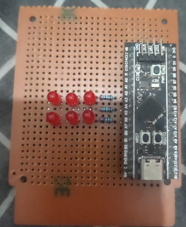
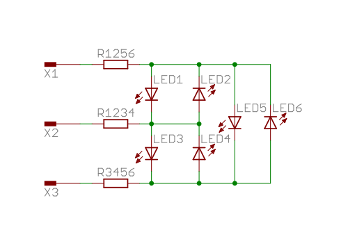

# STM32 Charlieplexing: 6 LEDs on 3 Pins

A simple example of driving **6 LEDs with only 3 GPIO pins** on an STM32 Black Pill using [Charlieplexing](https://en.wikipedia.org/wiki/Charlieplexing). It is written with STM32CubeIDE / HAL, and the pin switching is done with direct register access.



## What is Charlieplexing?

With `n` pins you can drive `n × (n − 1)` LEDs. For 3 pins that is 6 LEDs.

The trick is that each pin can be in one of three states:

| State | How | Role |
|---|---|---|
| **High** | Output, driven high | LED anode side |
| **Low** | Output, driven low | LED cathode side |
| **Hi-Z** | Input, no pull-up / pull-down | "Disconnected", does not affect anything |

To light one LED, one pin goes high, one goes low, and the third pin is set to Hi-Z so the other LEDs connected to it stay off. Only **one LED is on at a time**, so to show several LEDs you switch between them very quickly and persistence of vision does the rest.

## Hardware

- STM32 **Black Pill** (STM32F4, running at 84 MHz from the internal HSI + PLL)
- 6 LEDs
- 3 resistors (one per pin): `R1234`, `R1256`, `R3456` in the schematic. *(add your value here, e.g. 330 Ω)*
- Perfboard and wires

### Schematic



*Schematic taken from Wikipedia's Charlieplexing article.*

Each pair of pins has two LEDs wired in opposite directions (anti-parallel):

| Pins | LEDs |
|---|---|
| X1 ↔ X2 | LED1, LED2 |
| X2 ↔ X3 | LED3, LED4 |
| X1 ↔ X3 | LED5, LED6 |

### Pin mapping

| Schematic | Black Pill pin |
|---|---|
| X1 | **PA4** |
| X2 | **PA2** |
| X3 | **PA6** |

Black Pill pins to avoid for this kind of project: PA0 (user button), PC13 (onboard LED), PA11/PA12 (USB), PA13/PA14 (SWD debug).

### Truth table

| LED | Anode (High) | Cathode (Low) | Hi-Z |
|---|---|---|---|
| LED1 | PA4 | PA2 | PA6 |
| LED2 | PA2 | PA4 | PA6 |
| LED3 | PA2 | PA6 | PA4 |
| LED4 | PA6 | PA2 | PA4 |
| LED5 | PA4 | PA6 | PA2 |
| LED6 | PA6 | PA4 | PA2 |

## CubeMX configuration

Set **PA2, PA4, PA6** as `GPIO_Output` with:

- Output level: **Low**
- Mode: **Output Push-Pull**
- Pull: **No pull-up and no pull-down**
- Speed: **Low**

CubeMX only sets the *initial* state. Switching a pin between output and Hi-Z at runtime is done in our own code, below.

The clock is set up as HSI → PLL → 84 MHz (`PLLM = 8`, `PLLN = 84`, `PLLP = 2`).

## How the code works

### Register macros

```c
#define PIN_HIZ(port, n)  ((port)->MODER &= ~(3U << ((n)*2)))
#define PIN_OUT(port, n)  ((port)->MODER = ((port)->MODER & ~(3U << ((n)*2))) | (1U << ((n)*2)))
#define PIN_HI(port, n)   ((port)->BSRR = (1U << (n)))
#define PIN_LO(port, n)   ((port)->BSRR = (1U << ((n) + 16)))
```

- `MODER` has **2 bits per pin**: `00` = input (Hi-Z when there is no pull), `01` = output.
  - `PIN_HIZ` clears the pin's two bits, so it becomes a floating input.
  - `PIN_OUT` clears them and then sets the lower bit, so it becomes an output.
- `BSRR` is the bit set/reset register. Writing a 1 to bits 0-15 sets the pin high, and writing a 1 to bits 16-31 sets it low. Writing 0 does nothing, so only the chosen pin changes, in a single write.
- The output level is **pre-loaded with `BSRR` before the pin is switched to output**, so the pin goes straight to the right level without a glitch.

### One function per LED

```c
void led1() {
    PIN_HIZ(GPIOA, 6);                       // PA6 floating (unused)
    PIN_HI(GPIOA, 4);  PIN_OUT(GPIOA, 4);    // PA4 high (anode)
    PIN_LO(GPIOA, 2);  PIN_OUT(GPIOA, 2);    // PA2 low  (cathode)
}
```

`led2()` to `led6()` follow the same pattern, following the truth table above. Calling one of them turns on that LED and turns off the others, because the previous LED's pin states are overwritten.

### Showing several LEDs at once (multiplexing)

To make multiple LEDs appear lit together, the code cycles through them quickly with a 1 ms delay each:

```c
void led_2_1() {            // LED1 + LED6 together
    for (int i = 0; i <= 200; i++) {
        led1();
        HAL_Delay(1);
        led6();
        HAL_Delay(1);
    }
}
```

The demo functions are:

| Function | LEDs shown | Time per LED | Refresh rate per LED |
|---|---|---|---|
| `led_2_1()` | LED1 + LED6 | 1 ms | ~500 Hz |
| `led_2_2()` | LED2 + LED5 | 1 ms | ~500 Hz |
| `led_2_3()` | LED3 + LED4 | 1 ms | ~500 Hz |
| `led_3_1()` | LED1, 2, 3 | 1 ms | ~333 Hz |
| `led_3_2()` | LED4, 5, 6 | 1 ms | ~333 Hz |
| `led_full()` | All 6 | 1 ms | ~167 Hz |

Since each LED is only on for a fraction of the time, the more LEDs you show at once, the dimmer each one looks.

### Main loop

```c
while (1) {
    // 1. Each LED on its own, 500 ms each
    led1(); HAL_Delay(500);
    led2(); HAL_Delay(500);
    ...
    led6(); HAL_Delay(500);

    // 2. Pairs, then triples, then all six
    led_2_1(); led_2_2(); led_2_3();
    led_3_1(); led_3_2();
    led_full();
}
```

The full source is in [`Core/Src/main.c`](Core/Src/main.c).

## Notes and ideas for improvement

- `HAL_Delay()` blocks the CPU. A cleaner approach is to run the multiplexing from a **timer interrupt** (for example at 1 kHz), with a "current frame" variable that says which LEDs should be on.
- The register macros are written for the STM32F4 family (`MODER` / `BSRR`). On an STM32F1 (the older Blue Pill style), use `CRL` / `CRH` and `BRR` instead.
- Keep each LED current within the pin limits of the MCU. Every lit LED has one resistor on its high pin and one on its low pin, so choose values with that in mind.
- You can brighten LEDs shown together by reducing the number lit per cycle or by using a lower resistor value (within the current limits).

## License

*(add your license here, e.g. MIT)*
